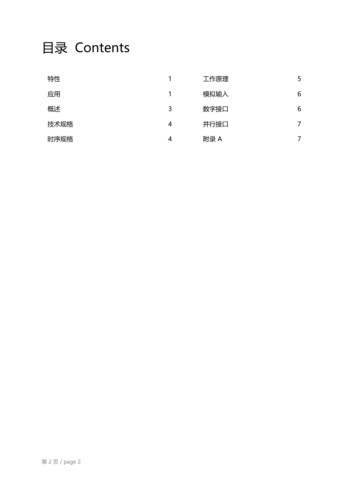

# pdf-toc

[中文说明](README.zh-CN.md) · English

An **Agent Skill** (Claude Code, Codex, Cursor — and DSH) that gives a PDF the table of contents it never had: a **nested bookmark outline** plus a **clickable printed TOC page**, written into a copy of the file and then **verified down to the pixel**.

```
probe  →  spec (JSON)  →  make  →  verify
  ↑          ↑             ↑         ↑
text layer?  titles you    outline   contract + all pages
headings?    actually read + links   render identically
```

The hard part is not writing bookmarks. It is knowing **what the sections are called** when the document lies to you — and proving you did not damage the pages on the way.



---

## Two traps this skill exists to avoid

**1. The mojibake trap.** Chinese datasheets exported by Illustrator/InDesign from around 2010 embed subset fonts like `/HYb2gj-GBK-EUC-H-Identity-H` with `/Encoding /Identity-H` and **no `/ToUnicode`**. Every extractor — pypdf, PyMuPDF, Acrobat's copy-paste, `pdftotext` — then returns glyph IDs instead of characters:

```
修订历史  →  Ϫ۩૦๏
数字滤波器 →  ຕጴ୳հഗ
```

In the reference file, **24.1 %** of extracted code points fall in Tibetan/Arabic/Armenian/Thai blocks and none in CJK. Character-count guessing, CID substitution tables and "looks close enough" all fail here — the same character has different IDs in the body, bold and heading fonts. The only reliable source of titles is **rendering the page and looking at it**. This skill ships the probe that detects it and the render step that fixes it.

**2. The translation trap.** Section names in a translated edition are not the English ones. On the AD7606 Chinese datasheet, *Power Dissipation* → **省电模式**, *Digital Output* → **数字滤波器**, *Application Hints* → **布局指南** — three of thirty entries would have been confidently wrong if generated from the English original. Read the page; never translate from memory.

---

## Requirements

| Need | Check |
|---|---|
| Python 3.9+ | `python -V` |
| `pypdf` | `python -c "import pypdf; print(pypdf.__version__)"` — `python -m pip install pypdf` |
| `pymupdf` | `python -c "import pymupdf"` — `python -m pip install pymupdf` |
| Eyes for the garbled case | the agent looks at a rendered PNG; a human looks at the page |

No Office, no Ghostscript, no browser, no network.

## Install

```bash
git clone https://github.com/ZihanZhang114514/pdf-toc
# then drop the folder where your host looks for skills, e.g.
#   ~/.claude/skills/pdf-toc           (Claude Code)
#   ~/.agents/skills/pdf-toc           (Codex / generic)
#   ~/.dsh/skills/pdf-toc              (DSH)
```

The skill is self-contained: `SKILL.md`, three scripts, one reference, one demo. Nothing to build.

## Quick start — the demo, end to end

```bash
python examples/build_demo.py
```

That writes `examples/demo.pdf` (8 pages, printed TOC, **zero** bookmarks) and `examples/demo_toc.json` (the spec, derived from the rendered PDF). Now:

```bash
python scripts/probe_pdf.py examples/demo.pdf
python scripts/make_toc.py examples/demo.pdf examples/demo_toc.json \
        -o examples/demo_outlined.pdf --force
python scripts/verify_toc.py examples/demo.pdf examples/demo_outlined.pdf \
        examples/demo_toc.json
```

```
wrote examples/demo_outlined.pdf
  pages          : 8
  bookmarks      : 11
  toc-page links : 10

  [PASS] page count unchanged  8 -> 8
  [PASS] bookmark count  expected 11, got 11
  [PASS] bookmark level/title/page in order
  [PASS] opens with the bookmark panel  PageMode=UseOutlines
  [PASS] toc-page link count  expected 10, got 10
  [PASS] toc-page link targets match spec
  [PASS] all 8 pages render identically @72dpi
ALL CHECKS PASSED
```

`examples/demo_outlined.pdf` is the result: open it and the bookmark panel is already showing.

## Your own file

### Probe first — always

```bash
python scripts/probe_pdf.py IN.pdf --render 2
```

```
outline   : 0 entries   <-- empty, this is what we add
text layer: garbled  (38014 chars, exotic 24.1%)
fonts     : Identity-H without /ToUnicode ->
            /HYb2gj-GBK-EUC-H-Identity-H
```

`ok` → read the titles from the text layer. `garbled` / `empty` → read them from the rendered PNG. The probe also lists heading candidates (`--min-size`, default 11 pt: body text is usually 9–10.5 pt) with the exact `y_top` value the spec wants.

### Numbers come from the text layer, words from the pixels

Even when every label is garbage, a printed TOC page keeps its structure and its page numbers under layout-mode extraction:

```
༬Ⴀ                                     1      ! ఇె๼෇                                      22
ᆌᆩ                                     1       ADCدڿࡧຕ                                    23
```

Two columns, rows in reading order, numbers intact. Pair row → number mechanically, then attach the titles you read off the image.

### Build and verify

```bash
python scripts/make_toc.py IN.pdf toc.json -o OUT.pdf     # never overwrites IN.pdf
python scripts/verify_toc.py IN.pdf OUT.pdf toc.json      # must print ALL CHECKS PASSED
```

## The spec

`make_toc.py` and `verify_toc.py` share one file, so the build is checked against its own contract.

```json
{
  "title": "AD7606 中文数据手册 Rev.0（含书签目录）",
  "page_offset": 0,
  "page_mode": "UseOutlines",
  "items": [
    {"title": "特性",     "page": 1,  "level": 1, "y": 128.0},
    {"title": "应用",     "page": 1,  "level": 1, "y": 218.0},
    {"title": "技术规格", "page": 4,  "level": 1},
    {"title": "时序规格", "page": 7,  "level": 2}
  ],
  "toc_page": {
    "page": 2,
    "row_height": 15,
    "columns": [{"x0": 35, "x1": 268}, {"x0": 295, "x1": 556}],
    "rows": [{"y": 128.0, "targets": [1, 22]}]
  }
}
```

| key | meaning |
|---|---|
| `items[].page` | **printed** page number → PDF index = `page - 1 + page_offset` (use `page_index` to name the index directly) |
| `items[].level` | `1` chapter, `2` section (child of the preceding level 1) |
| `items[].y` | distance from the page top to the top of the heading line — exactly the `y_top` the probe prints. Omit for page-top landings; supply it so bookmarks that share a page stop colliding |
| `toc_page.rows[].y` | same convention, one `targets` entry per column, in column order |
| `toc_page.columns` | x-range of each clickable cell; span the label, the leader dots and the page number |

Every target is validated **before** a byte is written: a page out of range is a hard error, not a silent no-op bookmark. Links get `/Border [0 0 0]` and `/F 4`, so they are invisible, printable and stretch across the whole row.

## What verification proves

- page count unchanged, and every page renders **pixel-identically** to the source (annotations must not move a single dot);
- bookmark count, nesting, order, title text and target page all match the spec;
- `PageMode` really is `/UseOutlines`;
- every `/Link` on the printed TOC page resolves to the page the spec names.

If pixels differ, something altered the content — rebuild from a pristine copy rather than patching the patched file.

## Files

```
SKILL.md                  the skill: when to use it, both workflows, gotchas
scripts/probe_pdf.py      text-layer verdict, font inventory, heading scan, page rendering
scripts/make_toc.py       outline bookmarks + clickable printed TOC, from the spec
scripts/verify_toc.py     contract assertions + pixel comparison
examples/build_demo.py    regenerates the demo PDF and its spec
references/pitfalls.md    the failure modes with measured numbers (pypdf API, coordinate systems, encoding)
```

## Limitations

- Two outline levels. Deeper hierarchies are flattened to level 2.
- Bookmarks jump to a page (optionally scroll to a `y`); they do not create new pages, so no TOC page is inserted if the document has none.
- Scanning is assumed to have happened already: for an image-only scan, the titles must come from OCR or from you reading the render — there is no text layer to pair with.
- No text is rewritten or re-typeset: this adds navigation, not content.
- PyMuPDF is AGPL-3.0 — hence this skill is AGPL-3.0-or-later.

## License

AGPL-3.0-or-later. See [LICENSE](LICENSE).
