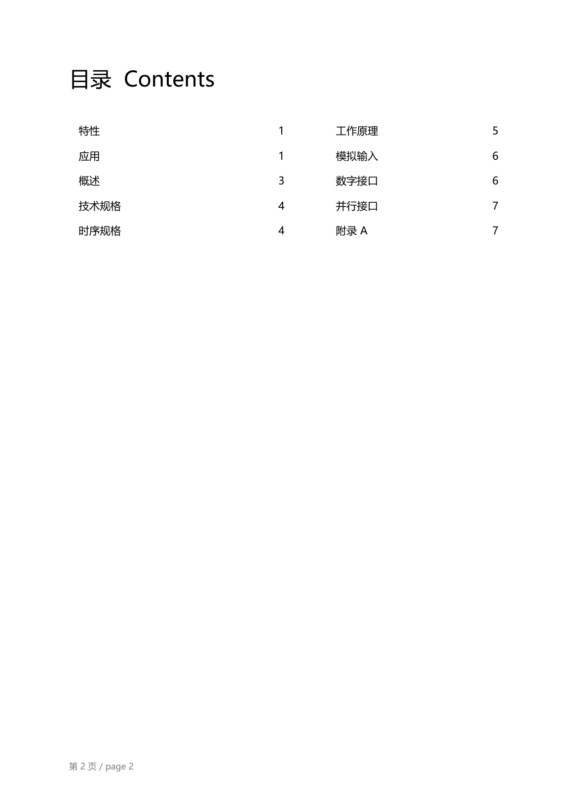

# pdf-toc

中文 · [English](README.md)

一个 **Agent Skill**（Claude Code、Codex、Cursor 以及 DSH）：给 PDF 补上它本来没有的目录 —— **多级书签**加上**可点击的原目录页**，写进副本文件，然后**核验到像素级**。

```
探测  →  spec（JSON）  →  生成  →  核验
 ↑          ↑              ↑        ↑
文字层可用？  你亲眼读到的标题  书签+链接  契约比对 + 全页渲染一致
```

难点从来不是写书签，而是：当文档"骗"你的时候，**章节到底叫什么**；以及证明补目录这件事**没有动过一个像素**。



---

## 这个 skill 专治两个坑

**坑一：乱码。** 2010 年前后用 Illustrator / InDesign 导出的中文数据手册，内嵌字体形如 `/HYb2gj-GBK-EUC-H-Identity-H`，`/Encoding` 是 `Identity-H` 且**没有 `/ToUnicode`**。于是所有提取器（pypdf、PyMuPDF、Acrobat 复制粘贴、`pdftotext`）拿到的都不是汉字，而是字形编号：

```
修订历史   →  Ϫ۩૦๏
数字滤波器  →  ຕጴ୳հഗ
```

实测那份 36 页 AD7606 手册：**24.1%** 的码位落在藏文／阿拉伯文／亚美尼亚文／泰文区段，汉字区段 0%。在这里，"数一下字数"、CID 替换表、"看着差不多"全部失效 —— 同一个字在正文、粗体、标题三种子集字体里的编号各不相同。唯一可靠的办法是**把页面渲染出来看**。本 skill 自带能诊断出这一点的探测脚本，也自带渲染步骤。

**坑二：翻译。** 中文版章节名不等于是英文版章节名。在 AD7606 中文手册里，*Power Dissipation* 对应**省电模式**、*Digital Output* 对应**数字滤波器**、*Application Hints* 对应**布局指南** —— 三十个条目里有三个会"自信地写错"，而且没人会发现，直到读者点进去。请读页面，不要凭英文原文翻译。

---

## 环境要求

| 需要 | 自检 |
|---|---|
| Python 3.9+ | `python -V` |
| `pypdf` | `python -c "import pypdf; print(pypdf.__version__)"` —— `python -m pip install pypdf` |
| `pymupdf` | `python -c "import pymupdf"` —— `python -m pip install pymupdf` |
| 乱码场景需要"眼睛" | 由 agent 看渲染出来的 PNG，或人自己看 |

不需要 Office、Ghostscript、浏览器，也不需要联网。

## 安装

```bash
git clone https://github.com/ZihanZhang114514/pdf-toc
# 然后把整个文件夹放进宿主查找 skill 的位置，例如：
#   ~/.claude/skills/pdf-toc           (Claude Code)
#   ~/.agents/skills/pdf-toc           (Codex / 通用)
#   ~/.dsh/skills/pdf-toc              (DSH)
```

自带全部内容：`SKILL.md`、三个脚本、一份参考、一个演示，无需构建。

## 快速开始 —— 跑一遍演示

```bash
python examples/build_demo.py
```

生成 `examples/demo.pdf`（8 页、带印刷目录页、**书签为 0**）和 `examples/demo_toc.json`（spec，由渲染后的 PDF 反推得到）。然后：

```bash
python scripts/probe_pdf.py examples/demo.pdf
python scripts/make_toc.py examples/demo.pdf examples/demo_toc.json \
        -o examples/demo_outlined.pdf --force
python scripts/verify_toc.py examples/demo.pdf examples/demo_outlined.pdf \
        examples/demo_toc.json
```

```
wrote examples/demo_outlined.pdf
  pages          : 8
  bookmarks      : 11
  toc-page links : 10

  [PASS] page count unchanged  8 -> 8
  [PASS] bookmark count  expected 11, got 11
  [PASS] bookmark level/title/page in order
  [PASS] opens with the bookmark panel  PageMode=UseOutlines
  [PASS] toc-page link count  expected 10, got 10
  [PASS] toc-page link targets match spec
  [PASS] all 8 pages render identically @72dpi
ALL CHECKS PASSED
```

打开 `examples/demo_outlined.pdf`，书签面板默认就是展开的。

## 处理你自己的文件

### 先探测，不要跳过

```bash
python scripts/probe_pdf.py IN.pdf --render 2
```

```
outline   : 0 entries   <-- empty, this is what we add
text layer: garbled  (38014 chars, exotic 24.1%)
fonts     : Identity-H without /ToUnicode ->
            /HYb2gj-GBK-EUC-H-Identity-H
```

判定 `ok` → 从文字层读标题；判定 `garbled` / `empty` → 从渲染出的 PNG 里读。探测还会列出标题候选（`--min-size`，默认 11pt —— 正文通常 9–10.5pt），并给出 spec 需要的 `y_top`。

### 数字取文字层，文字取像素

哪怕每个标签都是乱码，印刷目录页在 layout 模式下仍然保留结构与页码：

```
༬Ⴀ                                     1      ! ఇె๼෇                                      22
ᆌᆩ                                     1       ADCدڿࡧຕ                                    23
```

两栏、按阅读顺序、页码完好。机械地把"行 → 页码"配上，再贴上你从图里读到的标题即可。

### 生成与核验

```bash
python scripts/make_toc.py IN.pdf toc.json -o OUT.pdf     # 绝不覆盖 IN.pdf
python scripts/verify_toc.py IN.pdf OUT.pdf toc.json      # 必须打出 ALL CHECKS PASSED
```

## spec 格式

`make_toc.py` 与 `verify_toc.py` 共用同一份文件，所以"生成"是被"自己的契约"检验的。

```json
{
  "title": "AD7606 中文数据手册 Rev.0（含书签目录）",
  "page_offset": 0,
  "page_mode": "UseOutlines",
  "items": [
    {"title": "特性",     "page": 1,  "level": 1, "y": 128.0},
    {"title": "应用",     "page": 1,  "level": 1, "y": 218.0},
    {"title": "技术规格", "page": 4,  "level": 1},
    {"title": "时序规格", "page": 7,  "level": 2}
  ],
  "toc_page": {
    "page": 2,
    "row_height": 15,
    "columns": [{"x0": 35, "x1": 268}, {"x0": 295, "x1": 556}],
    "rows": [{"y": 128.0, "targets": [1, 22]}]
  }
}
```

| 字段 | 含义 |
|---|---|
| `items[].page` | **印刷页码** → PDF 索引 = `page - 1 + page_offset`（想直接写索引就用 `page_index`） |
| `items[].level` | `1` 章、`2` 节（挂在它前面最近的那个 1 级条目下） |
| `items[].y` | 页面顶端到标题行顶部的距离 —— 就是探测脚本打印的 `y_top`。不写则跳到页顶；写了，同页多个书签就不会都停在同一处 |
| `toc_page.rows[].y` | 同一套坐标；`targets` 按栏顺序给出各行目标页 |
| `toc_page.columns` | 每栏可点击的 x 范围；建议把标题、点线、页码一起覆盖进去 |

所有目标在**写盘之前**校验：页码越界直接报错，而不是悄悄生成一个点不动的书签。链接带 `/Border [0 0 0]` 与 `/F 4`，因此不可见、可打印、且横跨整行，点标题右侧的空白也能跳转。

## 核验到底证明了什么

- 页数不变，且**每一页渲染结果与源文件逐像素一致**（加注记不允许挪动一个点）；
- 书签数量、嵌套、顺序、标题文字、目标页全部与 spec 相符；
- `PageMode` 确实是 `/UseOutlines`（打开即显示书签面板）；
- 目录页上每一个 `/Link` 都落在 spec 指定的页。

像素不一致说明内容被改动了。正确做法是从**原始文件**重建，而不是去修补已经修补过的文件。

## 目录结构

```
SKILL.md                  技能本体：何时用、两条流程、坑
scripts/probe_pdf.py      文字层判定、字体清单、标题扫描、页面渲染
scripts/make_toc.py       按 spec 写入书签与可点击目录页
scripts/verify_toc.py     契约断言 + 像素比对
examples/build_demo.py    重新生成演示 PDF 与 spec
references/pitfalls.md    失败模式详解（pypdf API、坐标系、编码），带实测数字
```

## 局限

- 只支持两级目录，更深层级会被压平到第 2 级。
- 书签是"跳页 +（可选）滚动到某个 y"，不会新建页面；文档本身没有目录页时不会凭空插一页。
- 假定扫描件已经处理过：纯图像扫描没有文字层可配对，标题只能靠 OCR 或你自己看渲染图。
- 不改写、不重排任何文字 —— 这是加导航，不是改内容。
- PyMuPDF 是 AGPL-3.0，因此本 skill 也是 AGPL-3.0-or-later。

## 许可

AGPL-3.0-or-later，见 [LICENSE](LICENSE)。
